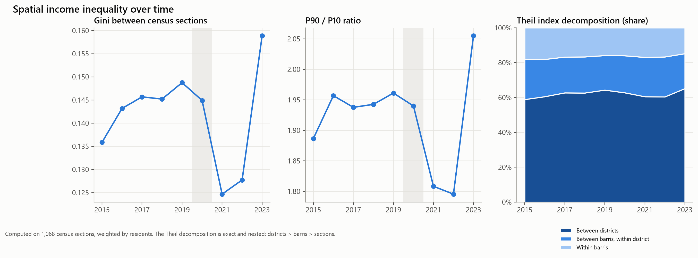
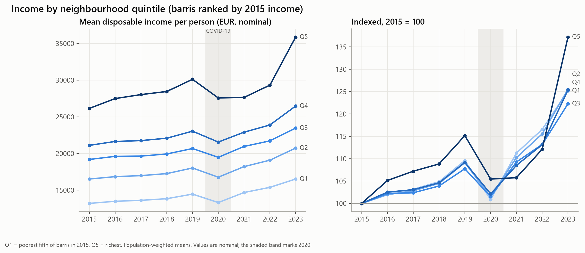
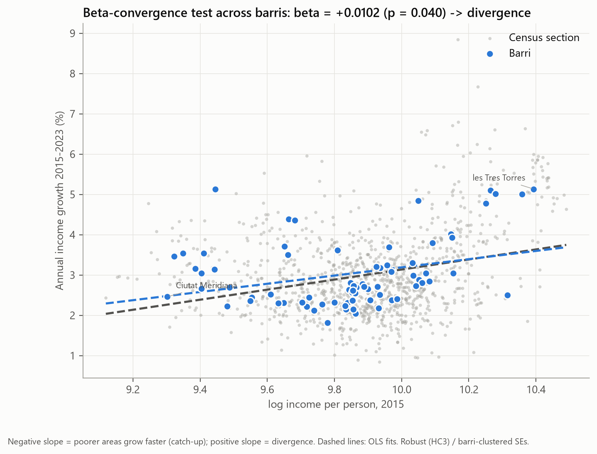
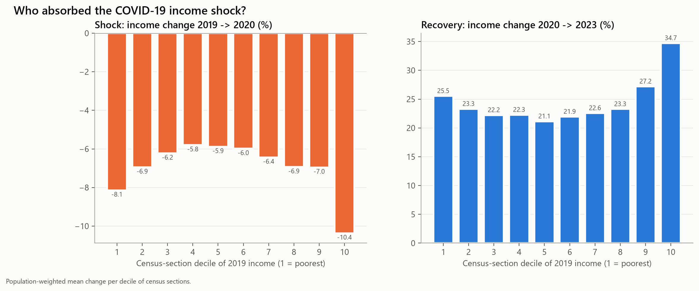
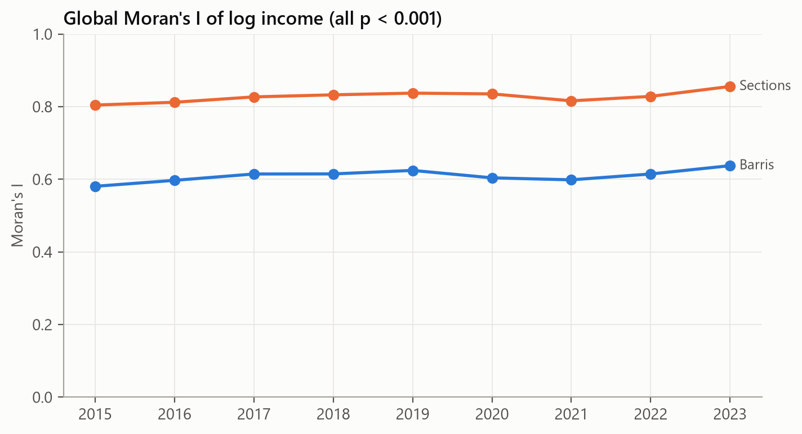
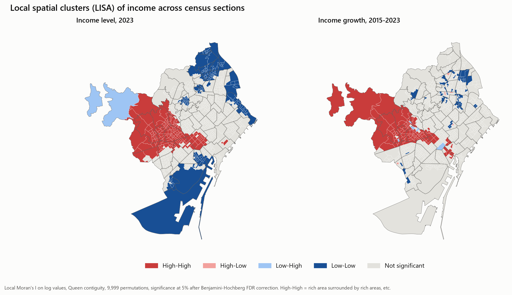
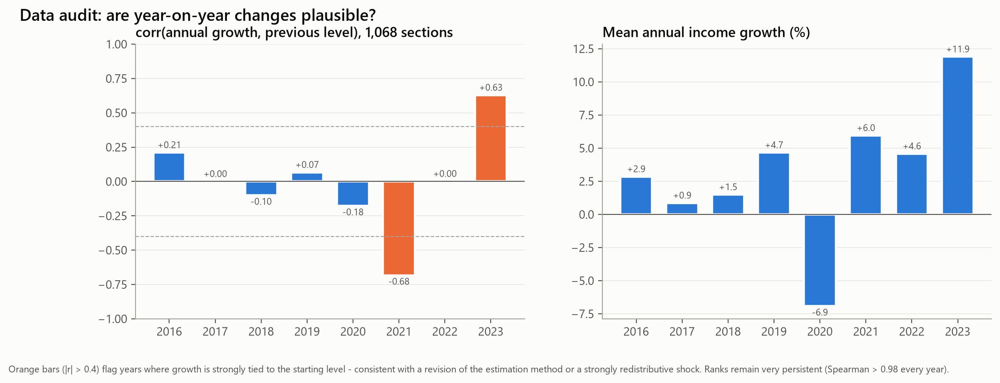
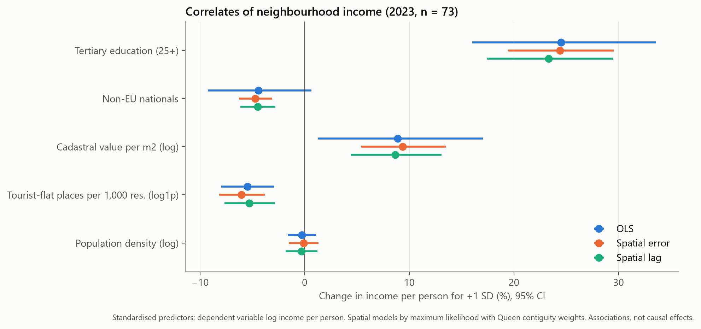
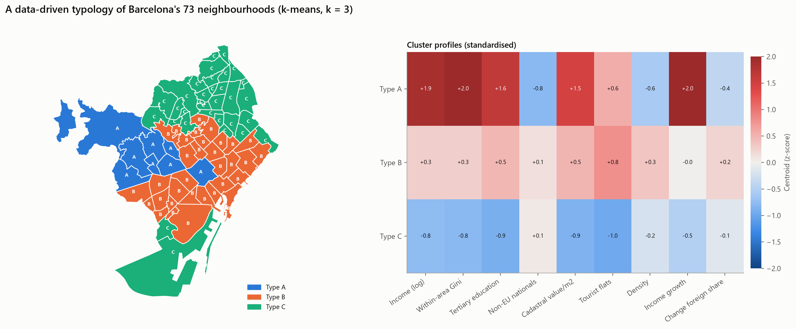
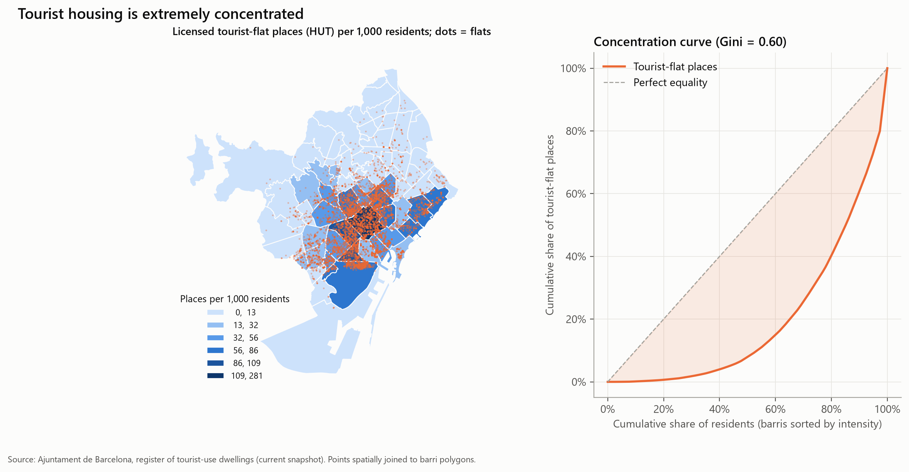

# Part I — Spatial income inequality in Barcelona, 2015–2023

*A reproducible study using Open Data BCN. All numbers in this report are produced by
`python -m bcn` and stored in [`results.json`](results.json) and [`tables/`](tables/).
Continued in [Part II — Education and inequality](02_education.md).*

---

## Executive summary

Barcelona's household disposable income per person rose from **€20,320 (2015) to €26,071
(2023)** in nominal terms. The gains were not evenly shared:

1. **Rich neighbourhoods grew faster.** Formal β-convergence tests show statistically
   significant **divergence** between neighbourhoods. This was already visible before the
   pandemic.
2. **The divide is mainly between districts, not within them.** 65% of spatial inequality
   lies between the 10 districts. Once district is controlled for, there is no residual
   divergence.
3. **The geography is extremely persistent and clustered.** Moran's I is 0.86 across
   census sections, and there are well-defined affluent (north-west) and deprived
   (north-east / Besòs) clusters.
4. **COVID-19 produced a U-shaped shock and a top-heavy recovery.**
5. **Education is by far the strongest correlate of neighbourhood income.** Tourist-flat
   intensity is high in affluent central areas but, *other things equal*, is associated
   with lower resident income.

The data contain two years with suspicious behaviour (2021, 2023). These are documented
and handled through robustness checks rather than ignored.

---

## 1. Research questions

| RQ | Question | Method |
|----|----------|--------|
| RQ1 | How large is spatial income inequality, and how has it evolved? | Gini, P90/P10, nested Theil decomposition |
| RQ2 | Are poorer areas catching up? | Absolute & conditional β-convergence |
| RQ3 | Who bore the COVID-19 shock and who recovered? | Decile analysis of section-level changes |
| RQ4 | Is income spatially clustered, and where? | Global Moran's I, LISA with FDR |
| RQ5 | Which neighbourhood characteristics are associated with income? | OLS + spatial lag/error models |
| RQ6 | Can neighbourhoods be grouped into meaningful types? | k-means with stability-based model selection |

## 2. Data

Seven datasets from Open Data BCN (CC BY 4.0) are joined at two geographic levels:

- **1,068 census sections** (*seccions censals*): income, Gini and residents. They are
  identical in number in every year 2015–2023, which allows a balanced panel.
- **73 neighbourhoods** (*barris*): the above aggregated with population weights, plus
  education, cadastral values and tourist flats.

Population-weighted aggregation is used because income is published *per person*: the
barri mean is Σ(pop × income) / Σ pop. Tourist flats are assigned to barris by a spatial
point-in-polygon join rather than through the registry's own barri field. Counts below 5
that are suppressed for confidentiality ("..") are imputed at 2.5, the expected value of
U{1..4}. Full details are in [`docs/methodology.md`](../docs/methodology.md).

## 3. RQ1 — How unequal, and is it changing?

| Indicator | 2015 | 2019 | 2023 |
|---|---:|---:|---:|
| Gini between sections | 0.136 | 0.149 | 0.159 |
| P90 / P10 | 1.89 | 1.96 | 2.06 |
| Theil T | 0.030 | 0.036 | 0.042 |

*(Full series: [`tables/inequality_by_year.md`](tables/inequality_by_year.md).)*

A Gini of 0.16 between *areas* may look modest. It is a **lower bound**: it treats everyone
in a section as earning the section mean. The residents-weighted mean of the INE
*within-section* Gini is about 32, so most interpersonal inequality happens inside small
areas. What this study measures is **spatial sorting**.

**Nested Theil decomposition (2023).** The Theil index decomposes exactly:

| Component | Share |
|---|---:|
| Between the 10 districts | **65.1%** |
| Between barris, within the same district | 20.0% |
| Between sections, within the same barri | 14.8% |

The district share rose from 59% (2015) to 65% (2023). Inequality is increasingly a
matter of *which part of the city* you live in.

## 4. RQ2 — Convergence or divergence?

We estimate (1/T)·ln(yT/y0) = α + β·ln(y0) + ε. A negative
β means catch-up.

| Specification | β | SE | p | Verdict |
|---|---:|---:|---:|---|
| Barris, absolute (n = 73), HC3 | +0.0102 | 0.0050 | 0.040 | divergence |
| Sections, absolute (n = 1,068), clustered by barri | +0.0125 | 0.0049 | 0.011 | divergence |
| Sections + non-EU share + **district FE** | +0.0003 | 0.0037 | 0.945 | none |

**Interpretation.** Richer areas grew faster. The divergence vanishes inside districts,
which means it is driven by the affluent districts (Sarrià-Sant Gervasi, Les Corts, parts of
Eixample) pulling away *as blocks*, not by micro-level sorting within neighbourhoods.

## 5. RQ3 — The COVID-19 shock

- **Shock (2019→2020):** the poorest decile of sections lost 8.1%, the richest 10.4%, and
  the middle about 6%. The pattern is U-shaped and consistent with job losses in low-wage
  services at the bottom and falls in capital and business income at the top.
- **Recovery (2020→2023):** the richest decile rebounded **+34.7%** vs. about 22% in the
  middle and 25.5% at the bottom. Sections that fell more bounced back more (r = −0.51).
  The *net* effect still favoured the top.

## 6. RQ4 — Spatial clustering

Global Moran's I of log income is very high and slightly rising: **0.80 → 0.86** for
sections and **0.58 → 0.64** for barris (all p < 0.001, 9,999 permutations).

Local Moran's I is computed with a **Benjamini–Hochberg** correction, because 1,068
simultaneous tests at α = 5% would otherwise yield about 53 false positives:

- **Income level 2023:** 162 *High-High* sections form one contiguous affluent belt
  (Pedralbes – Sarrià – Sant Gervasi – Dreta de l'Eixample). 154 *Low-Low* sections sit in
  Nou Barris and Sant Andreu (Ciutat Meridiana, Torre Baró, Trinitat), the Besòs and the
  Zona Franca / Marina.
- **Income growth 2015–2023:** of the 113 *High-High* growth sections, **98 (87%)** are
  also in the affluent *level* cluster. This is the spatial footprint of divergence: fast
  growth surrounded by fast growth, in the places that were already richest.

## 7. Robustness

### 7.1 Series audit

Under a stable estimation method, annual growth should be roughly unrelated to the starting
level. Two years break this pattern:

| Year | Mean growth | corr(growth, previous level) | Rank persistence (Spearman) |
|---|---:|---:|---:|
| 2021 | +6.0% | **−0.68** | 0.985 |
| 2023 | +11.9% | **+0.63** | 0.985 |

Rankings are almost perfectly preserved, so these are **level / scale effects**, not
noise. They could come from revisions in the Idescat/INE-based estimation, or from genuinely
redistributive events: ERTE furloughs and the *Ingreso Mínimo Vital* compressing 2021,
and capital-income and wage normalisation widening 2023. The data cannot separate the two
explanations, so conclusions should not depend on either year.

### 7.2 Convergence by time window (sections, barri-clustered SEs)

| Window | β | p | Verdict |
|---|---:|---:|---|
| **2015–2019 (pre-COVID, clean)** | **+0.0125** | **0.031** | **divergence** |
| 2015–2020 | +0.0077 | 0.019 | divergence |
| 2015–2022 | −0.0129 | <0.001 | convergence |
| 2015–2023 | +0.0125 | 0.011 | divergence |
| 2019–2023 | +0.0122 | 0.001 | divergence |
| 2021–2023 | +0.1011 | <0.001 | divergence |

Divergence appears in every window except 2015–2022, which is the only window that contains
the 2021 compression but not the 2023 reversal. **The divergence result does not depend on
the 2023 figures.**

## 8. RQ5 — What is neighbourhood income associated with?

Cross-section of 73 barris (2023). Dependent variable: log income per person. Predictors
are standardised, so each coefficient is the % change in income for +1 SD.

| Predictor | OLS effect (+1 SD) | p (HC3) |
|---|---:|---:|
| Tertiary education, age 25+ | **+24.5%** | <0.001 |
| Cadastral value per m² (log) | +8.9% | 0.021 |
| Tourist-flat places per 1,000 residents (log1p) | **−5.5%** | <0.001 |
| Non-EU nationals share | −4.4% | 0.087 |
| Population density (log) | −0.3% | 0.71 |

R² = 0.954 (adj. 0.950).

**Spatial diagnostics.** The covariates absorb the spatial structure entirely:

| Test | Statistic | p |
|---|---:|---:|
| Moran's I of residuals | −0.055 | 0.87 |
| LM lag / robust LM lag | 0.75 / 1.42 | 0.39 / 0.23 |
| LM error / robust LM error | 0.55 / 1.21 | 0.46 / 0.27 |

Spatial lag (ρ = 0.05, p = 0.41) and spatial error (λ = −0.24, p = 0.22) models produce
almost identical coefficients and do not improve AIC meaningfully. OLS is adequate here.

**Collinearity.** Education and cadastral value are highly correlated (r = 0.93;
VIF = 9.7 and 8.1). Dropping cadastral value
([`tables/ols_sensitivity_no_cadastral.md`](tables/ols_sensitivity_no_cadastral.md))
raises the education effect to +34% and leaves the tourist-flat coefficient negative and
significant (−4.8%, p = 0.006). The non-EU coefficient is not robust (p = 0.18).

**The tourism paradox.** Unconditionally, tourist-flat intensity is *positively* correlated
with income (Spearman ρ = +0.65), because tourist flats cluster in central, educated, expensive
neighbourhoods. Conditional on education and property values, the sign flips. Among
neighbourhoods with similar human capital and housing stock, those with more tourist flats
have lower resident incomes. This is consistent with displacement / composition effects,
but **this cross-section cannot establish causality** (reverse causation and omitted
variables remain plausible).

## 9. RQ6 — A typology of neighbourhoods

Nine standardised indicators: income, within-area Gini, education, non-EU share, cadastral
value, tourist intensity, density, income growth, and change in foreign share. The rule for
choosing *k* was fixed before looking at the clusters: k ≥ 3 (k = 2 just splits rich/poor),
bootstrap stability ARI ≥ 0.6, no cluster under 3 barris, then the best silhouette. This
gives **k = 3** (silhouette 0.30, stability ARI 0.70).

| Type | Barris | Residents | Income | Tertiary | Tourist places / 1,000 | Income growth 2015–23 | Within-area Gini |
|---|---:|---:|---:|---:|---:|---:|---:|
| **A — Affluent uptown** | 8 | 206k | €41,091 | 60% | 53 | +46% | 38.3 |
| **B — Central & mixed, high tourism** | 33 | 920k | €26,125 | 42% | 41 | +27% | 32.2 |
| **C — Peripheral working-class** | 32 | 535k | €19,499 | 21% | 2 | +23% | 28.5 |

Members of each type: [`tables/typology_members.md`](tables/typology_members.md).
Agreement with Ward hierarchical clustering is moderate (ARI = 0.54). The A/C extremes are
robust, while the B/C boundary is fuzzy. Treat the typology as descriptive.

## 10. Tourist housing

There are 10,719 licensed tourist flats with 61,833 places. Their distribution is highly
unequal: Gini = 0.60 across residents, and **10 barris hold 68% of all places**.
La Dreta de l'Eixample alone has 281 places per 1,000 residents.

## 11. Limitations

- **Ecological inference.** All measures are area averages. Conclusions apply to places, not
  to individuals.
- **Nominal income.** No deflator is applied. This does not affect inequality ratios,
  rankings or convergence slopes (a common deflator cancels out), but it does affect
  level comparisons across years.
- **Series breaks.** See §7.1.
- **Snapshot covariates.** Tourist flats (current register, no illegal listings) and
  cadastral values (2023) are not time-varying here, which rules out panel identification.
- **Small n.** With 73 barris and correlated covariates, coefficient-level conclusions are
  fragile. The section-level analyses (n = 1,068) are more robust.

## 12. Implications

1. Area-based policies (e.g. the *Pla de Barris*) are well targeted: deprivation is spatially
   concentrated, persistent and statistically identifiable (Low-Low clusters).
2. Because most spatial inequality is between districts, city-wide redistribution tools
   matter more than within-district fine-tuning.
3. The negative conditional association between tourist flats and resident income supports
   continued monitoring of tourism pressure in Type B neighbourhoods. A panel design with
   time-varying licence data would be the natural next step to test causality.

## Next steps

- Extend income to 2024+ when published and re-run the series audit.
- Add rental prices (Generalitat deposit data) to model housing affordability.
- Panel / difference-in-differences design around the 2014 tourist-licence moratorium.
- Interactive dashboard (Streamlit / Observable) on top of `data/processed/`.

## References

- Anselin, L. (1988). *Spatial Econometrics: Methods and Models*. Kluwer.
- Anselin, L. (1995). Local indicators of spatial association — LISA. *Geographical Analysis*, 27(2).
- Barro, R. & Sala-i-Martin, X. (1992). Convergence. *Journal of Political Economy*, 100(2).
- Benjamini, Y. & Hochberg, Y. (1995). Controlling the false discovery rate. *JRSS B*, 57(1).
- Shorrocks, A. (1980). The class of additively decomposable inequality measures. *Econometrica*, 48(3).
- Rey, S. & Anselin, L. (2007). PySAL: A Python library of spatial analytical methods.
